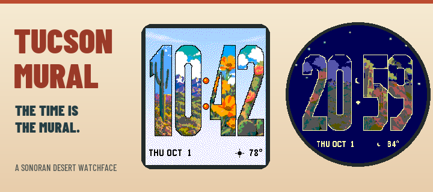

# Tucson Mural

**The time itself is the mural.** A Pebble watchface with bold numerals filled with original Tucson and Sonoran Desert illustrations.



Morning, day, sunset, and night palettes change the background and the artwork inside each number. The ten scenes feature Catalina Mountains, a saguaro, prickly pear, a Gila monster, wildflowers, San Xavier-inspired architecture, Tucson courthouse-inspired architecture, a hummingbird, an owl, and a Gambel's quail. Illustrations were developed with AI assistance and adapted to Pebble's limited resolution and color palette.

## Install version 1.0.0

[Download the PBW](releases/tucson-mural-1.0.0.pbw?raw=true) and open it with the Pebble phone app. It uses the same UUID as the development versions, preserving settings when updated. This repository includes the publication candidate; an app-store listing has not been published.

| Platform | Models | Display |
|---|---|---|
| Emery | Pebble Time 2 | 200 × 228 color |
| Gabbro | Pebble Round 2 | 260 × 260 color |
| Basalt | Pebble Time / Time Steel | 144 × 168 color |

The original Time Round and monochrome models are future ports and are not supported by this build.

## Features and settings

- Four large mural numerals; respects the watch's 12/24-hour setting.
- Local date and weather, with Fahrenheit or Celsius.
- Optional Low Vision Mode enlarges the date/weather line while preserving the mural background.
- Optional Bluetooth disconnect icon and a single disconnect vibration; vibration defaults off.
- Minute updates and no decorative animation. Weather normally refreshes every 30 minutes.

Open the watchface settings in the phone app to configure these options. Weather requires phone location permission and internet access; the clock works without weather. Lighting uses fixed local periods: morning 06:00–09:59, day 10:00–16:59, sunset 17:00–19:59, night 20:00–05:59. These are artistic periods, not calculated sunrise/sunset times.

Read the [user guide](user-guide.md), [privacy and attribution](privacy-and-attribution.md), and [validation details](validation.md). Weather data by [Open-Meteo](https://open-meteo.com/), [CC BY 4.0](https://creativecommons.org/licenses/by/4.0/); temperatures are rounded and converted for display. The current weather endpoint is intended for a free, non-commercial release.

## Build and verify

Use the Pebble SDK 4.17 and native Linux Node in WSL. From the repository root:

```sh
npm ci
pebble build
node tests/companion_test.js
cc -std=c99 -Wall -Wextra -Werror tests/policy_test.c -o /tmp/tucson-policy-test
/tmp/tucson-policy-test
python tools/validate_time_fit.py
```

The build validates every time from 00:00 through 23:59 on each target: 4,320 cases, including colon spacing and the round-screen boundary. Resource packs are 162,252 bytes on Emery, 205,612 on Gabbro, and 88,396 on Basalt, each below 256 KiB. Dependency versions are locked; Clay is pinned to 1.0.10.

Omit `POC_THEME`, `POC_HOUR`, and `POC_MINUTE` environment overrides for live builds. These variables are reserved for fixed design reviews. The supplied PBW is a live build. Artwork regeneration uses Pillow and the scripts in `tools/`; compiled resources are included, so Pillow is not required for the standard SDK build.

The optional `tools/capture_release.py` helper needs the Pebble tool's Python environment (`libpebble2`, `pebble_tool`, and Pillow), rather than an unrelated system Python. It installs the supplied PBW on SDK emulators and injects controlled clock/weather fixtures for review. Its output defaults to the ignored `build/capture-review/` directory.

The user has approved time and larger-footer readability on a physical watch. SDK emulator captures cover all three models; multi-day battery life has not been measured.

## Repository contents

- `src/`: native C watchface and PebbleKit JS companion/settings.
- `resources/`: display-specific digit tiles and background palettes.
- `art/`: original illustration sources, revisions, and generation prompt provenance.
- `tools/` and `tests/`: asset generation, time-fit validation, policy and companion checks.
- `store-assets/`: banner, optional icons, and five native screenshots per platform.
- `publication/`: draft store copy and release notes.
- `releases/`: version 1.0.0 PBW and SHA-256 checksum.

No open-source license has been selected for the original code or artwork. Third-party notices are retained in `licenses/`. Store publication is a separate step.
